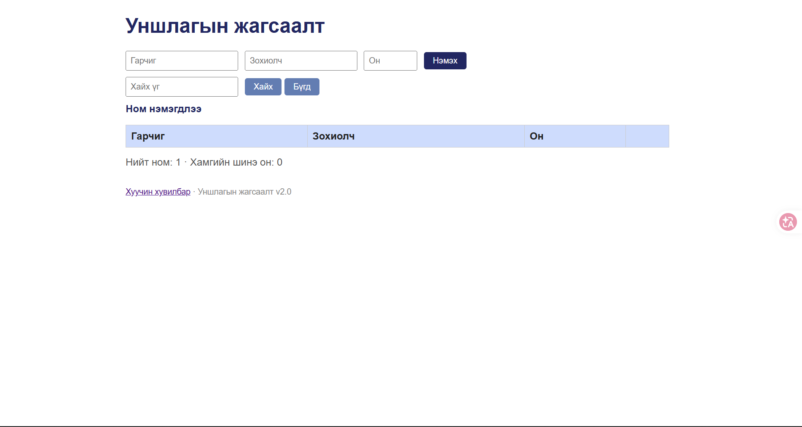

# BUG-02: Номыг устгахад «Ном нэмэгдлээ» гэсэн буруу мессеж гарна

**Орчин:** Уншлагын жагсаалт v2.0, Google Chrome, Windows 11 (Git Bash), Node.js v18.19.0, 2026-10-21

**Урьдчилсан нөхцөл:** `node app.js`-ийг шинээр асаасан (анхны 3 ном), браузерт http://localhost:3000 нээсэн

## Дахин гаргах алхам

1. Хуудсыг нээ (дээр нь ямар ч мессеж байхгүйг шалга).
2. «Clean Code» мөрийн «Устгах» товчийг дар.

**Хүлээгдэж байсан:** «Үйлдэл бүрийн дараах мессеж тухайн үйлдэлдээ тохирно» — устгасны дараа «Ном устгагдлаа» гэх мэт мессеж гарах ёстой.

**Бодит үр дүн:** Ном хүснэгтээс арилж 2 ном үлдэнэ, гэтэл дээр нь «Ном нэмэгдлээ» гэж бичигдэнэ.

**Ноцтой байдал:** Minor — өгөгдөл зөв устсан ч хэрэглэгчийг төөрөгдүүлнэ.

**Хавсралт:** [screenshots/bug-02.png](../screenshots/bug-02.png)

**Олдсон аялал:** Supermodel

