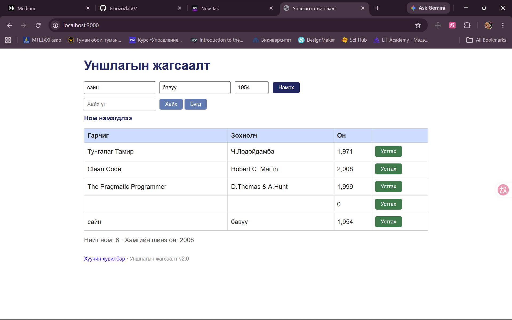

# BUG-03: Гарчиг, Зохиолч, Он хоосон байхад ном нэмэгдэж хоосон мөр үүснэ

**Орчин:** Уншлагын жагсаалт v2.0, Google Chrome, Windows 11 (Git Bash), Node.js v18.19.0, 2026-10-21

**Урьдчилсан нөхцөл:** `node app.js`-ийг шинээр асаасан (анхны 3 ном), браузерт http://localhost:3000 нээсэн

## Дахин гаргах алхам

1. Гарчиг, Зохиолч, Он гурван талбарыг хоосон үлдээ.
2. «Нэмэх» товчийг дар.

**Хүлээгдэж байсан:** «Ном нэмэхэд Гарчиг, Зохиолч, Он гурван талбар бүгд заавал бөглөгдсөн байх ёстой; дутуу бол ном нэмэгдэхгүй, ойлгомжтой алдааны мессеж харагдана.»

**Бодит үр дүн:** «Ном нэмэгдлээ» мессеж гарч, хүснэгтэд гарчиг, зохиолчгүй, Он баганад `0` гэсэн мөр нэмэгдэнэ.

**Ноцтой байдал:** Major — оролтын шалгалт огт байхгүй, хог өгөгдөл хадгалагдана.

**Хавсралт:** [screenshots/bug-03.png](../screenshots/bug-03.png)

**Олдсон аялал:** Couch Potato

