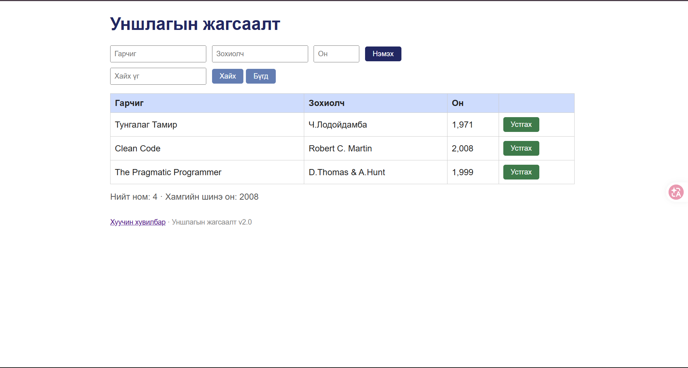

# BUG-04: Хүснэгтийн Он баганад он мянгатын таслалтай (1,971) харагдана

**Орчин:** Уншлагын жагсаалт v2.0, Google Chrome, Windows 11 (Git Bash), Node.js v18.19.0, 2026-10-21

**Урьдчилсан нөхцөл:** `node app.js`-ийг шинээр асаасан (анхны 3 ном), браузерт http://localhost:3000 нээсэн

## Дахин гаргах алхам

1. Хуудсыг нээгээд анхны 3 номын Он баганыг хар.

**Хүлээгдэж байсан:** «Он … хүснэгтэд энгийн тоогоор (жишээ нь 1999) харагдана.»

**Бодит үр дүн:** `1,971`, `2,008`, `1,999` гэж таслалтай харагдана. Шинээр нэмсэн ном ч мөн адил (2001 → `2,001`).

**Ноцтой байдал:** Cosmetic — өгөгдөл зөв, зөвхөн харагдац буруу.

**Хавсралт:** [screenshots/bug-04.png](../screenshots/bug-04.png)

**Олдсон аялал:** Supermodel

