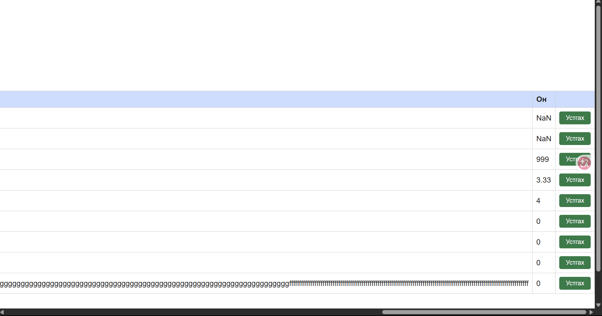

# BUG-06: Он талбарт тоо биш утга болон 1000–2100-аас гадуурх, бутархай утгыг хүлээн авна

**Орчин:** Уншлагын жагсаалт v2.0, Google Chrome, Windows 11 (Git Bash), Node.js v18.19.0, 2026-10-21

**Урьдчилсан нөхцөл:** `node app.js`-ийг шинээр асаасан (анхны 3 ном), браузерт http://localhost:3000 нээсэн

## Дахин гаргах алхам

1. Гарчиг: `Он тест`, Зохиолч: `Тестер`, Он: `abc` → «Нэмэх».
2. Гарчиг: `Он тест 2`, Зохиолч: `Тестер`, Он: `999` → «Нэмэх».
3. Гарчиг: `Он тест 3`, Зохиолч: `Тестер`, Он: `3.33` → «Нэмэх».

**Хүлээгдэж байсан:** «Он нь 1000-2100 хоорондох бүхэл тоо» — бусад утгад ном нэмэгдэхгүй, алдааны мессеж гарах ёстой.

**Бодит үр дүн:** Гурвуулаа нэмэгдэнэ: Он баганад `NaN`, `999`, `3.33` харагдана. Алдааны мессеж гарахгүй.

**Ноцтой байдал:** Major — буруу өгөгдөл хадгалагдаж, «Хамгийн шинэ он» статистикийг гажуудуулна.

**Хавсралт:** [screenshots/bug-06.png](../screenshots/bug-06.png)

**Олдсон аялал:** Couch Potato

