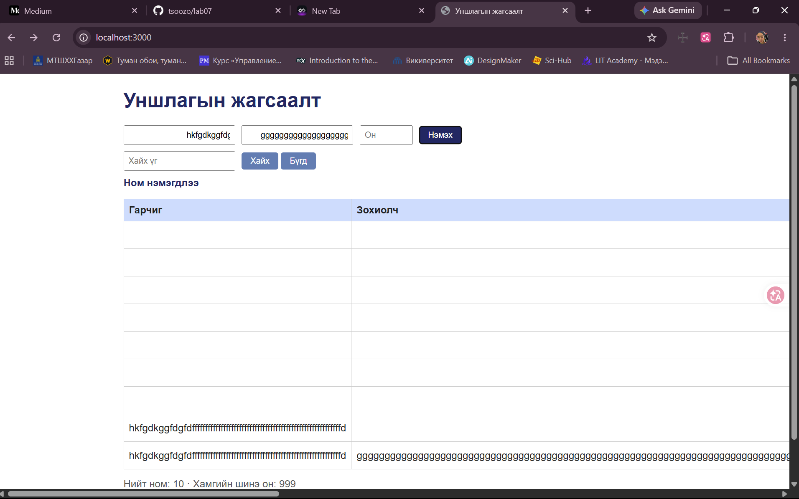

# BUG-07: Хоосон зайгүй урт гарчиг/зохиолч хүснэгтийг дэлгэцнээс хальж эвдэнэ

**Орчин:** Уншлагын жагсаалт v2.0, Google Chrome, Windows 11 (Git Bash), Node.js v18.19.0, 2026-10-21

**Урьдчилсан нөхцөл:** `node app.js`-ийг шинээр асаасан (анхны 3 ном), браузерт http://localhost:3000 нээсэн

## Дахин гаргах алхам

1. Гарчиг талбарт хоосон зайгүй 100-аас дээш тэмдэгт оруул (жишээ нь `f` үсгийг олон удаа), Зохиолч: `Урт`, Он: `2000`.
2. «Нэмэх» дар.

**Хүлээгдэж байсан:** «Хүснэгт ямар ч урттай оролтод эвдрэхгүй.»

**Бодит үр дүн:** Хүснэгт хуудасны өргөнөөс хальж, хэвтээ гүйлгэх мөр гарна; Он болон «Устгах» баганууд дэлгэцийн гадна түлхэгдэнэ.

**Ноцтой байдал:** Minor — уншигдах байдал муудаж, «Устгах» товчинд хүрэхэд саад болно.

**Хавсралт:** [screenshots/bug-07.png](../screenshots/bug-07.png)

**Олдсон аялал:** Couch Potato

