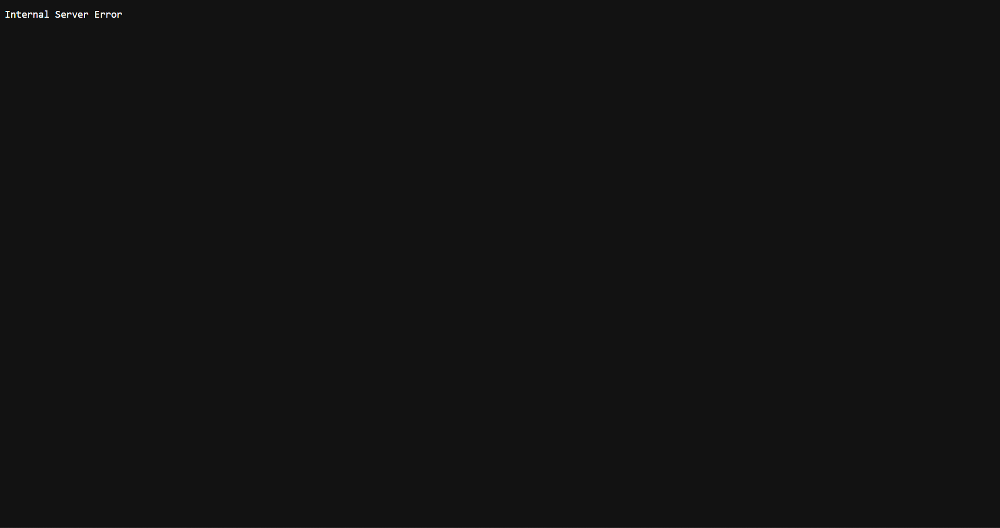

# BUG-09: Хөлийн «Хуучин хувилбар» линк 500 Internal Server Error өгнө

**Орчин:** Уншлагын жагсаалт v2.0, Google Chrome, Windows 11 (Git Bash), Node.js v18.19.0, 2026-10-21

**Урьдчилсан нөхцөл:** `node app.js`-ийг шинээр асаасан (анхны 3 ном), браузерт http://localhost:3000 нээсэн

## Дахин гаргах алхам

1. Хуудасны доод хэсгийн «Хуучин хувилбар» линк дээр дар.
2. (API) `curl -i localhost:3000/old`

**Хүлээгдэж байсан:** «Бүх хуудас, линк ажиллана.»

**Бодит үр дүн:** Хар дэлгэцэн дээр «Internal Server Error» гэж гарна; curl → `HTTP/1.1 500 Internal Server Error`.

**Ноцтой байдал:** Minor — үндсэн функцэд нөлөөгүй ч эвдэрсэн линк, серверийн алдаа.

**Хавсралт:** [screenshots/bug-09.png](../screenshots/bug-09.png) · [evidence/bug-09-curl.txt](../evidence/bug-09-curl.txt)

**Олдсон аялал:** Supermodel

