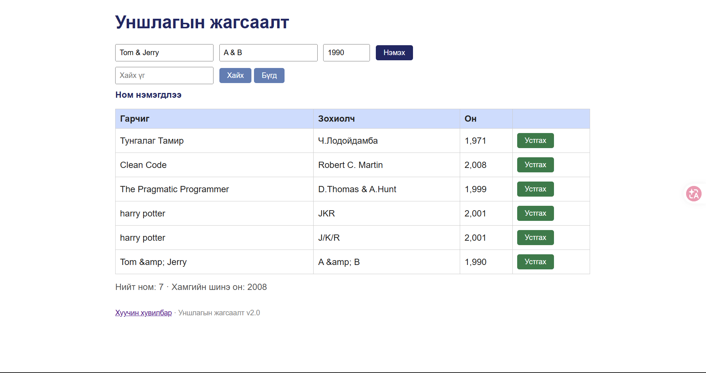

# BUG-10: «&» тэмдэгттэй гарчиг/зохиолч «&amp;» болж хадгалагдаж, тэгж харагдана

**Орчин:** Уншлагын жагсаалт v2.0, Google Chrome, Windows 11 (Git Bash), Node.js v18.19.0, 2026-10-21

**Урьдчилсан нөхцөл:** `node app.js`-ийг шинээр асаасан (анхны 3 ном), браузерт http://localhost:3000 нээсэн

## Дахин гаргах алхам

1. Гарчиг: `Tom & Jerry`, Зохиолч: `A & B`, Он: `1990` → «Нэмэх».
2. Хүснэгтийн шинэ мөрийг хар.
3. (API) `curl -i localhost:3000/api/books` — хадгалагдсан утгыг хар.

**Хүлээгдэж байсан:** Эрүүл ухаан: оруулсан текст яг хэвээрээ харагдах ёстой (анхны «D.Thomas & A.Hunt» зөв харагддаг шиг).

**Бодит үр дүн:** Хүснэгтэд `Tom &amp; Jerry`, `A &amp; B` гэж харагдана. API-д ч `"title":"Tom &amp; Jerry"` гэж эвдэрсэн хэлбэрээр хадгалагдсан.

**Ноцтой байдал:** Major — хэрэглэгчийн өгөгдөл хадгалахдаа эвдэрнэ (өгөгдлийн түвшний согог).

**Хавсралт:** [screenshots/bug-10.png](../screenshots/bug-10.png) · [evidence/bug-10-curl.txt](../evidence/bug-10-curl.txt)

**Олдсон аялал:** Saboteur

