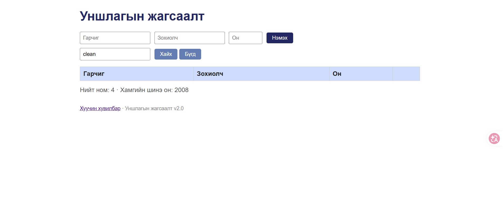
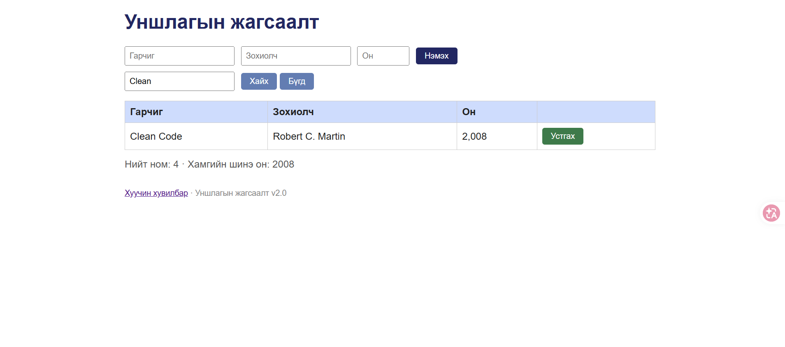

# BUG-11: Хайлт том/жижиг үсэг ялгадаг — «clean» гэж хайхад «Clean Code» олдохгүй

**Орчин:** Уншлагын жагсаалт v2.0, Google Chrome, Windows 11 (Git Bash), Node.js v18.19.0, 2026-10-21

**Урьдчилсан нөхцөл:** `node app.js`-ийг шинээр асаасан (анхны 3 ном), браузерт http://localhost:3000 нээсэн

## Дахин гаргах алхам

1. «Хайх үг» талбарт `clean` (жижиг үсгээр) бичээд «Хайх» дар.
2. Талбарыг `Clean` (том үсгээр) болгоод «Хайх» дар.

**Хүлээгдэж байсан:** «Хайлт гарчиг болон зохиолчоос хайх ба том/жижиг үсэг ЯЛГАХГҮЙ.»

**Бодит үр дүн:** `clean` → хүснэгт хоосон (0 үр дүн); `Clean` → «Clean Code» олдоно.

**Ноцтой байдал:** Major — үндсэн функц спецификацаас зөрж, хэрэглэгч байгаа номоо олохгүй.

**Хавсралт:** [screenshots/bug-11.png](../screenshots/bug-11.png) · [screenshots/bug-11-b.png](../screenshots/bug-11-b.png)

**Олдсон аялал:** Fed-Ex

