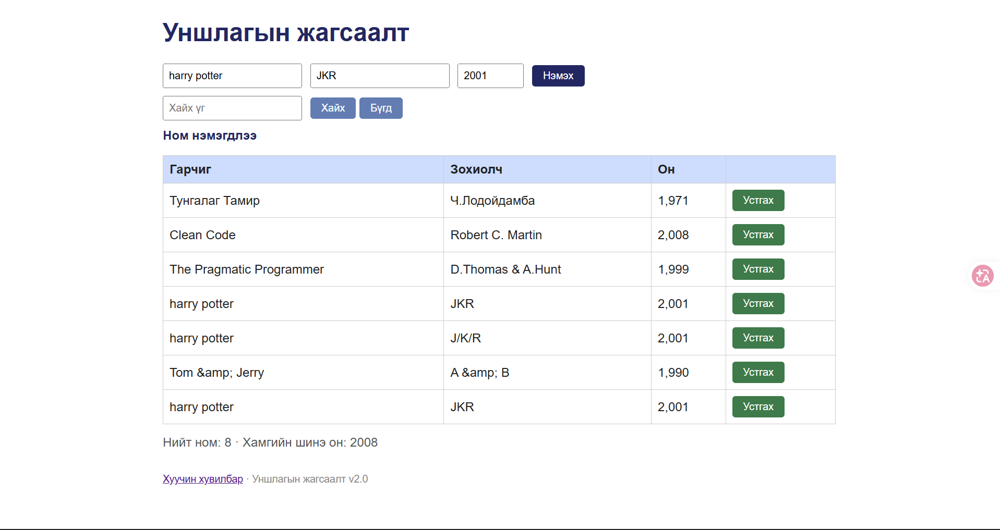

# BUG-12: Ижил гарчиг, зохиолчтой номыг давхардуулан нэмэх боломжтой

**Орчин:** Уншлагын жагсаалт v2.0, Google Chrome, Windows 11 (Git Bash), Node.js v18.19.0, 2026-10-21

**Урьдчилсан нөхцөл:** `node app.js`-ийг шинээр асаасан (анхны 3 ном), браузерт http://localhost:3000 нээсэн

## Дахин гаргах алхам

1. Гарчиг: `Clean Code`, Зохиолч: `Robert C. Martin`, Он: `2008` → «Нэмэх».

**Хүлээгдэж байсан:** «Ижил гарчиг, зохиолчтой ном давхардуулж нэмэгдэхгүй.»

**Бодит үр дүн:** «Ном нэмэгдлээ» гарч, хүснэгтэд хоёр «Clean Code / Robert C. Martin» мөр үүснэ. Session-ий үеэр «harry potter / JKR»-ийг хоёр удаа нэмэхэд мөн давхардсан; API-д id 4 ба 7 ижил.

**Ноцтой байдал:** Major — өгөгдлийн бүрэн бүтэн байдлын дүрэм зөрчигдөнө.

**Хавсралт:** [screenshots/bug-12.png](../screenshots/bug-12.png) · [evidence/bug-12-curl.txt](../evidence/bug-12-curl.txt)

**Олдсон аялал:** Fed-Ex

